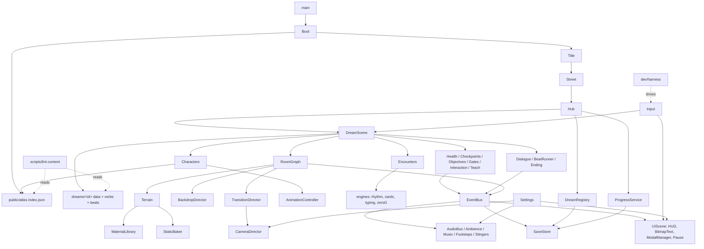

# Dreamcatcher: architecture plan for the redesign

Status: PLAN for the owner to review. No game code has been changed.
Inputs: `01_gamer_critique.md` (raw), `02_final_critique.md` (governs where they disagree; cited below as **F§n** for sections and **F#n** for the ranked problems in F§2), and the owner decisions below.

**Owner decisions treated as fixed:**
- THE LAST STOP / THE LONG EVENING is an ordinary train, open at any time, with no lock and no dream count to clear. This overrides F#12 (the part about gating), F§4.1 "explicit lock" and decision 9 (the gating half).
- Everything may be redesigned.
- Characters use stored image assets: multi-view, multi-frame atlases.
- The art source is laid out as options (§3). It is not decided here.
- All tooling must be free. The machine is an 8 GB Mac, so local image generation is out. The owner will not supply assets by hand.

**Open decisions from F§7 that this plan does NOT decide:** 1 (how many dreams), 2 (dream length), 3 (Painter), 4 (order), 5 (failure model details), 6 (art source), 7 (size and camera), 8 (minigames), 9 (hub length), 10 (the Counter). Every component below is built to serve either answer. §8.1 lists where an answer changes the plan.

---

## 1. Summary

### 1.1 Diagnosis: what in today's structure produced the problems

| Structural cause (today) | Where | Problems it produced |
|---|---|---|
| **One monolith scene per dream** (1,045–2,678 lines each), sharing only `BaseLevel.js` (553 lines). Verbs, puzzles, beats, HUD, cast and art all live in the scene. | `src/scenes/*Scene.js` | F#1 scope (every dream re-invents its plumbing, so polish never reaches all of them), F#11 one ending template copy-pasted, F#15 per-dream drift (Painter has no hearts, "DREAM 03", wrong landmark) |
| **One ground material per dream**, tinted per room. The autotile has lip/body/edge but no variants, no decoration layer, no enclosure layer, and no props-by-rule. | `src/data/*/tiles.js` (`material:`), `builders/autotile.js`, `art/levelArt.js` | F#3 flat ground, F§5.1 no enclosure, B9 carpet outdoors |
| **The world is one strip of rooms stitched left to right; the "current room" is `roomAt(player.x)`.** Backdrop, music and zoom all switch as events on that frame: one threshold, a 550 ms tween, and the horizon assigned raw. | `RoomBuilder.roomAt` (`RoomBuilder.js:197`), `BaseLevel.updateMusicRoom` (`:468-486`), `parallax.setRoom` (`parallax.js:1067-1132`) | F#4 background snap (256 px in one frame), T2a flicker on the line, B7 backdrop seams |
| **Failure is a single hit → teleport to the flag; game over → `scene.restart()`.** The save holds no in-dream state. | `BaseLevel.hurt` (`:415-455`), `sectionRestart` (`:266`), `utils/save.js` | F#2 the failure loop, C3 retry replays the dialogue, F#5 flags feel random |
| **Flags, gates and objectives are unrelated free-floating calls**: `activateCheckpoint` swaps a texture, `Gate` has no requirement display, `setObjective(text)` is called from scene code. | `BaseLevel.js:396,457`, `entities/Gate.js` | F#5, M1 stale objective, X1 arbitrary flag density |
| **Tutorial cards are ids fired from scene code with a global seen-once list, and nothing checks they are reachable.** | `systems/tutorial.js`, `showTutorial(` calls | F#6: 13 dead cards, the EVA death trap, overflow, never retaught |
| **Independent modals at hard-coded depths, with no queue.** `showCard`, the tutorial card, puzzle panels and `DialogueBox` all draw on the world camera. | `BaseLevel.showCard` (`:487`), `tutorial.js`, `*Puzzles.js` | F#6 BET card hidden (depth 240 vs 300), B2 death card over a tutorial card, F#10 stacking |
| **The HUD lives on the world camera** (`setScrollFactor(0)`), so it scales with zoom. Text is Phaser `Text` in monospace (198 uses), with no layout system. | `BaseLevel.setupCommon` (`:34-80`), every scene | F#7 HUD shrinks at zoom 0.8/0.62, F#8 text, A2 HUD overload |
| **Characters are runtime string-art grids**, one texture per pose, swapped with `setTexture('jo-run')`, and there is no animation state machine. `public/atlas/jo.png/.json/.meta.json` exist (walk 8 + idle 8, with `stride`/`contacts` foot-lock data) but **nothing loads them**. `scripts/build-atlas.js` (D11) was never written. The PNG override hook is wired to the Evening only. | `entities/jo.js`, `Player.js:250`, `art/overrides.js`, `public/atlas/` | F#9 thin move set, float uses the run pose, no portraits |
| **Dialogue is one box type, triggered by proximity or by script, and it freezes Jo.** | `systems/DialogueBox.js`, `HubScene.js:1148` | H2, F§5.5 (barks vs scenes), C3 |
| **Minigames are modal menus over the platformer, and their logic is mixed into their presentation.** | `gamblerPuzzles.js` (980 lines), `puzzles.js`, `rhythm.js` | F#10, M2 "same Simon" presentation |
| **Ambience is declared but unread** (`ambientLoop` in `data/dreams.js`). There is no SFX bus and no footstep surfaces. Only the Evening has `soundscape.js`. | `data/dreams.js`, `systems/audio.js` | F#14 |
| **No boot/title flow**: `main.js` boots straight into the Hub ("never on a menu"). Dev warps are five ad-hoc URL params. | `src/main.js` | F#12 no title/continue, no tutorial street, X3 |
| **Painted backdrops are runtime-drawn full-viewport tileSprites (1,746×2,700), and the Evening places ~14,000 display objects.** Nothing is baked. | `builders/parallax.js`, `scenes/evening/world.js`, `art/eveningArt.js` | F#15 perf, F§5.13 |
| **The content lint checks geometry and coin budgets only** (`scripts/lint-rooms.js`). It does not check tutorials, gates, objectives, reachability or art. | `scripts/lint-rooms.js` | F#6 dead cards shipped, X1, the overlapping interacts in the Painter |

**The short version.** The engine pieces are good: physics feel, autotile, the painters, rhythm, typing and card logic, the board, the sky. The problem is that they are wired *per dream*, by *x position* and by *hard-coded depth*. Every fix had to be made seven times, so it never was.

### 1.2 Target architecture (one page)

```
Boot ─► Title (Continue / New / Settings) ─► Street (tutorial) ─► Hub ─► DreamScene(dreamId) ─► Hub … ─► Evening (a DreamScene profile)
                                                     ▲ UIScene runs in parallel on top of every gameplay scene
```

1. **One generic `DreamScene`** plays any dream from a **DreamDefinition** (data). Dream-specific behaviour lives in small **verb modules** (trumpet, pen, zero-g, brush, bet…) and **beat scripts** (staged story moments). The hub and the Evening use the same services with different profiles (`noFail`, `noHud`). A dream becomes about 300–600 lines of data and verbs, not 2,000 lines of scene.
2. **World = a RoomGraph.** Each room is its own enclosed grid with its own terrain material, backdrop set, objective, ambience and checkpoints. Rooms connect through **portals** of two kinds:
   - a *seam* (arch, tunnel mouth or fog bank, crossed continuously, with the blend driven by camera distance);
   - a *door* (a short fade-through-black, with the next room streamed in).
   Only the current room and its neighbours are live.
3. **Terrain = material + rules.** Autotile (47-blob) with a lit lip, body, underside, 3–4 hashed variants, an edge-fringe rule layer, a prop layer and a foreground enclosure layer. Static parts are baked to RenderTexture chunks.
4. **Characters = atlases + manifest + AnimationController.** Every character is an atlas pack with a manifest (frame size, foot anchor, views, animations, stride, contacts, events). A shared state machine maps physics state to animation, with fallback chains and velocity-locked playback. Missing art falls back to an auto-generated placeholder under the *same frame names*, so code never branches on art.
5. **Services (scene plugins) shared by every scene:** EventBus, Input (actions + gamepad), CameraDirector, Health/Failure, Checkpoints, SaveStore (with in-dream runs), Objectives, Interaction, Dialogue (caption bar + scene box), Teach, Encounters (in-world minigames), Audio (buses, ambience, stems, footsteps), Settings.
6. **UI on its own scene** (`UIScene`), immune to world zoom: BitmapText (2 sizes + display), a HUD grid with fixed slots and a layout budget, a ModalManager with a queue, and the pause menu.
7. **Build-time asset pipeline** (`scripts/build-atlas.js`, Node, free libraries only): composes rigs or imported sheets into atlases, fonts into BMFont, and backdrop generators into baked PNG layers. It writes `public/atlas/index.json`, which Boot loads.
8. **Content lint + test harness.** `lint-content` validates every room, portal, gate, tutorial, objective, checkpoint, interactable, character manifest and art budget. A deterministic step harness (`window.__dc`) drives the game with the pane hidden and captures screenshots.

---

## 2. Component catalogue

Effort: **S** ≤ 2 days, **M** 3–8 days, **L** 2–4 weeks (one agent-assisted developer).

### 2.1 Dream framework: `DreamScene`, DreamDefinition, verb modules, beat runner
- **Purpose.** Replace the six per-dream monoliths with one scene class plus data, so every fix lands everywhere.
- **Resolves.** F#1 (scope: makes a dream cheap, and makes cutting or postponing one a data flag); F#11 (shared `EndingSequence`); F#15 per-dream drift ("DREAM 03", wrong landmark, the Writer emblem, Painter without hearts); F§5.10 consistency.
- **Responsibilities.**
  - Load a DreamDefinition and build the RoomGraph.
  - Instantiate services with the dream's profile.
  - Register verb modules and run beat scripts on events.
  - Own the dream lifecycle: `enter → play → ending → return`.
  - Apply difficulty-by-count (darkening overlay, max hearts) from `ProgressService`.
- **Interface.**
  - `DreamScene.init({ dreamId, resume?: RunState, warp?: {room, checkpoint} })`
  - A verb module: `{ id, keys: ['action1'], create(ctx), update(ctx, dt), onEvent(ctx, evt), hudWidget?: WidgetDef, teach?: [cardId] }`
  - `ctx` = `{ scene, world, player, services, run }`
  - `BeatRunner.play(beatId)`: beats are arrays of steps, `{say}`, `{camera:{push:1.6, to:'npc:nia', ms:600}}`, `{anim:{who:'jo', name:'pawn_case'}}`, `{wait:400}`, `{set:'flag.x'}`, `{hud:'hide'}`, `{music:'stem:solo'}`, `{choice:[...]}`, and are awaitable.
  - `EndingSequence.play(def)`: played beat → orb → short line, with per-dream content.
- **Replaces.**
  - `src/scenes/{Chef,Musician,Astronaut,Writer,Painter,Gambler}Scene.js`
  - `src/scenes/BaseLevel.js`, split into services
  - `src/scenes/painter/{beats,world,util}.js` and `src/scenes/evening/world.js`, which become dream data + verbs
  - the unreferenced `SelectScene.js`
  - The per-dream puzzle files (`puzzles.js`, `astroPuzzles.js`, `writerPuzzles.js`, `painterPuzzles.js`, `gamblerPuzzles.js`) split into *engine* (pure logic, kept) and *encounter presentation* (rewritten under 2.10).
- **Depends on.** All services; RoomGraph (2.2).
- **Effort.** L, done once. After that each dream is M.

### 2.2 Room graph, portals and transitions: `RoomGraph`, `RoomStreamer`, `TransitionDirector`
- **Purpose.** Rooms are enclosed places, and moving between them is a visible, smooth event. This is the fix spec for the background snap.
- **Resolves.** F#4; T2a; B7; F§5.2 (all six points); F§5.1 enclosure; F#3 (rooms are where material changes); F#15 darkZone persistence (room-scoped overlays die with their room).
- **Responsibilities.**
  - Place rooms at world origins (contiguous rooms keep continuous coordinates).
  - Stream rooms: current + neighbours live, the rest destroyed.
  - Compute `currentRoom` from the **camera centre with hysteresis**, never from the player x.
  - For each **seam portal**, compute `t = smoothstep(x0 - w, x0 + w, cam.midPoint.x)` every frame (default `w = 300`, per portal). Feed that `t` to:
    - BackdropDirector: both rooms' layer sets alive, alpha `1-t`/`t`, horizon `lerp(hA, hB, t)` — never assigned raw;
    - CameraDirector: zoom `lerp`;
    - Ambience: crossfade.
  - Music and objective switch at `t` crossing 0.5, with ±1 tile of hysteresis.
  - **Door portals:** on interact or overlap, a 250 ms fade to black, swap, fade in. Entry spawns at the paired portal.
  - Prebuild the next room's scenery when the camera is within `w + 400` px.
  - Lint: every boundary between two rooms must be a declared portal with a physical seam prop (arch, door frame, tunnel, fog).
- **Interface.**
  - `RoomGraph.fromDefinition(def)`
  - `rooms.get(id)`, `rooms.current`, `rooms.blend` → `{ a, b, t } | null`
  - Events: `room:enter`, `room:leave`, `portal:cross`
  - `TransitionDirector.go(portalId)` for doors
- **Replaces.** `RoomBuilder.build`'s stitching loop (the room part), `RoomBuilder.roomAt`, `BaseLevel.updateMusicRoom`, `parallax.setRoom`'s event tween. The `RoomBuilder` terrain code moves to 2.3.
- **Depends on.** Terrain, Backdrop, CameraDirector, Audio, EventBus.
- **Effort.** M.
- **Note.** The room model supports both answers to decision 2. Short dreams need 4–6 rooms; long ones need the same code with more rooms.

### 2.3 Terrain, decoration, props and enclosure: `Terrain`, `MaterialLibrary`, `DecorRules`, `PropLibrary`, `StaticBaker`
- **Purpose.** End "one tinted slab per dream". Every room has its own floor that reads as a material, with edges, variants and life.
- **Resolves.** F#3, T1, B9 (carpet outdoors), A3 (crater has no ground read), F§5.1 (one material per room, lip/body/underside, 3–4 variants, prop fringe, enclosure, hazard colour rule, designed dark/unpainted states), F§4.2/4.4/4.5/4.7 floor per section, E2/F§4.8 painted Evening foreground.
- **Responsibilities.**
  1. **Collision** stays an ASCII grid (the current `legend.js` roles: solid, one-way, stair, ramp, ladder, climbable `|`, hazard, loose). It is diffable and lintable, and an agent can author it.
  2. **Material per room**, with an optional per-region override (`regions: [{rect, material}]`). A material defines its tiles under 47-blob autotile masks:
     - top-lit lip (left/mid/right caps);
     - body (3–4 variants, picked by a position hash);
     - underside/overhang;
     - inner corners;
     - slope pieces;
     - a "wear" overlay (reusing `autotile.wearAt`).
  3. **DecorRules**: declarative rules over the grid, e.g. `{ when: 'topExposed', material:'grass', place:'fringe_grass', chance:.8 }` and `{ when:'ceilingExposed', place:'drip|cable' }`, plus puddles in hollows and crumbs at the base of walls. Seeded, so the result is deterministic.
  4. **Props**: authored placements (`{prop:'stove', x, y, layer:'mid'|'fg'|'bg', collide?, interact?}`) from a per-dream prop library. A prop is an atlas frame and may be animated.
  5. **Enclosure layer**: back wall, ceiling band, door frames and pillars rendered in the foreground (`D.fg`), so entering a room is visible.
  6. **State skins** for "designed" states:
     - unpainted → sepia sketch (Painter, B8);
     - dark zone → feathered fog (B5);
     - hazard colour reserved (red-orange) and checked by lint.
  7. **StaticBaker**: bake the terrain, decor and static props of each room into RenderTexture chunks (≤1024 px wide) when the room streams in. Free them when it streams out.
- **Interface.**
  - `Terrain.build(room, material) → { colliders, surfaceAt(tx,ty) → 'tile'|'wood'|'carpet'|..., bakedChunks }` (surface feeds footsteps, 2.13)
  - `Material = { id, frames: {...}, variants, surface, palette, fringe }`
  - `DecorRule = { when, place, chance, layer, seed }`
- **Replaces / refactors.**
  - `builders/RoomBuilder.js` (terrain half), `builders/autotile.js` (kept, extended to 47-blob and variants), `builders/legend.js` (kept), `builders/supports.js` (kept, as a decor rule)
  - `art/levelArt.js` (material painters become MaterialLibrary generators, baked at build time)
  - `data/*/tiles.js` → `dreams/<id>/materials.js` (several materials per dream)
- **Depends on.** Asset pipeline (2.17), RoomGraph, depths (`builders/depths.js`, kept).
- **Effort.** L: the pipeline is M, plus materials per dream as content.

### 2.4 Backdrop and parallax: `BackdropDirector`, backdrop generators
- **Purpose.** Keep the good painted skies and backdrops, make transitions continuous (2.2), and make them cheap.
- **Resolves.** F#4 (with 2.2), B7 seams, F#15 / F§5.13 perf (1,746×2,700 tileSprites).
- **Responsibilities.**
  - Each room declares a `backdrop` set: sky, far, mid, near, landmark, weather, plus a horizon y.
  - The director keeps the sets of the current and blending rooms alive and applies `t`.
  - Layers are **pre-baked PNGs** produced at build time from today's generator code (`parallax.js` kinds, `horizon.js`, `sky.js`), at most 2× viewport width and tiled, instead of being drawn at runtime.
  - Animated parts (sky cycle, weather, town lights) stay live but budgeted.
  - Room-scoped overlays (darkZone, fog) belong to a room and fade with `t`.
- **Interface.**
  - `BackdropDirector.setBlend({a, b, t})`, `update(cam)`
  - `BackdropSet = { sky, layers:[{key, scroll:{x,y}, y, tile:true}], horizon, landmark, weather, overlays }`
- **Replaces / refactors.**
  - `builders/parallax.js` (1,133 lines): generators kept and moved to `art/backdrops/`; `setRoom` and its tween deleted.
  - `systems/horizon.js`, `systems/sky.js`, `systems/weather.js`: kept as live layers.
  - `utils/backdrop.js`: legacy, delete.
- **Depends on.** Pipeline (bake), RoomGraph.
- **Effort.** M.

### 2.5 Character system: atlases, manifests, `AnimationController`, `CharacterRegistry`
- **Purpose.** Frame-based, multi-view characters that move like people, from stored images, with the same faces across hub, dream and Evening.
- **Resolves.** F#9, T6/T6a, B6 presentation (float pose, rotation), F§5.4 (whole list), F§4.6 performed pawning and empty-hand idle, E2 (crowd depth and body types), F#7 scale (frame size is a manifest value, so decision 7 is a number).
- **Responsibilities.**
  1. **Manifest per character** (`art/characters/<id>/manifest.js`, schema in §4.6):
     - frame size, foot anchor;
     - views (`side` flippable, `three_q` for dialogue scenes, `portrait`);
     - outfits;
     - animations, with fps or `stride` (px per cycle) for velocity lock;
     - `contacts` per frame (foot-down frames, as already in `public/atlas/jo.meta.json`);
     - frame events (`footstep`, `release`, `hit`);
     - attach points (hand, hat, tool).
  2. **Loader.** Boot reads `public/atlas/index.json` and `load.atlas` for each pack, then registers Phaser animations from manifests. A **lazy pack** per dream is loaded on dream entry and unloaded on exit (memory).
  3. **AnimationController** (one per actor):
     - a state machine whose states follow the character-motion skill §5 (`idle, walk, run, start, skid, turn, jump_anticipate, rise, apex, fall, land_soft, land_hard, crouch, crouch_walk, slide, wall_slide, wall_jump, ledge_grab, hang, pull_up, climb, push, carry_*, interact, hurt, knockback, ko, respawn, sit, sleep, talk_*, float, swim, …` plus verb states);
     - transitions from physics + input + `body.blocked`, never from animation completion alone;
     - **fallback chain** per animation (`land_hard → land_soft → idle`, `crouch_walk → walk`, `float → fall`) so missing frames degrade gracefully and are logged once;
     - **velocity-driven playback:** `frameRate = |vx| / stride × frames`, with snapping so the contact frame lands on a foot plant (no foot slide);
     - turn and skid inserts, a hat-lag secondary layer, attach-point sprites (trumpet, case, plate);
     - the `float` state allows rotation.
  4. **Placeholder fallback.** When a pack or animation is missing, the build generates a labelled placeholder strip under the same frame names from today's string-art Jo (`entities/jo.js`) or a generic silhouette. A dev overlay counts the placeholders.
  5. **Palette/outfit variants.** Recolour happens at build time (a palette map per outfit), not with a runtime shader. This keeps atlases simple, and the darkening stays the existing overlay.
  6. **Crowd builder.** 3 body types × N palettes × idle/walk/sit/clap. A depth-band placement helper spreads people over three baselines with scale and tint (E2).
- **Interface.**
  - `Characters.spawn(id, {x, y, outfit, view, controller:'player'|'npc'|'foe'}) → Actor`
  - `actor.anim.set(state, {force})`, `actor.anim.playOnce(name) → Promise`, `actor.face(dir)`
  - `actor.attach(slot, frame)`
  - `Characters.has(id, anim)`
- **Replaces / refactors.**
  - `entities/jo.js`, `entities/foeArt.js`, `entities/hubArt.js`, `data/*/sprites.js` person parts, `data/evening/sprites.js createPersonTextures`, `utils/pixelart.js` in the hot path (it stays for placeholders and dev).
  - `art/overrides.js`, generalised into the pipeline.
  - `Player.js`: **keep its physics** (coyote 100 ms, buffer 120 ms, variable jump, F§5.13) and move all rendering to the controller.
  - `Foe.js`, `Townsfolk.js`, `Companion.js`, `critters.js` become controllers + behaviours.
- **Depends on.** Pipeline (2.17), Input, EventBus (frame events → audio).
- **Effort.** L. Code is M; art volume is L, and depends on §3.

**Animation list per character type.** This is the full F§5.4 list, tiered so the reference dream can ship before the whole cast exists. Tiers: P0 = needed for any playable dream, P1 = the reference dream and hub, P2 = per dream as rebuilt.

| Type | Animations (frames) | Tier |
|---|---|---|
| **Jo core** | idle breath 6, blink 2, look-around 6; walk 8; run 8; start 2; skid/stop 3; turn 3; jump anticipation 2, rise 2, apex 1, fall 2; land soft 2, land hard 3; hurt 3; knockback 3; KO 6; respawn/wake 4; interact/reach 3 | P0 |
| | crouch idle 2; crouch-walk 6; slide 3; wall-slide 2; wall-jump 3; ledge grab, hang 2, pull-up 5; ladder climb 6 + idle 1; push 6; carry idle 2, carry walk 8; pick up/put down 4; hide in cover 3 | P1 |
| | talk gestures nod/shrug/point 3 each; sit down 4, sit idle 2, sleep 2; look up 2; wave 4; laugh (Evening) | P1 |
| **Jo per dream** | chef: stir 4, carry plate 8, slide plate 4 · musician: play stand 4, long note 2, walk-play 8, kneel-play 4, case open/close 4 · astronaut: float idle 4 (rotatable), push-off 3, rail crawl 6, tether reel 4, moon bound 4, swim 6, carry Priya walk 8 · writer: type 4, pen strike 4, pick word 3 · painter: brush stroke 5, held stroke 4, palette idle 2 · gambler: sit at table 3, play card 3, push chips 3, poker-face hold 2, empty-hand idle 6, pawn case · evening: walk-with-her 8, hand-hold idle, pet dog 4, sit together 2 | P2 |
| **Jo outfits** | street (default), bare-headed, chef whites, suit / EVA suit, smock, gambler coat. Build-time recolour or part swap; P0 = street | P0/P2 |
| **Jo portraits** | neutral, smile, doubt, tired, afraid, relieved, laugh, crying (96×96); `three_q` view for dialogue scenes | P1 |
| **Speaking NPCs** (Pemberton, Ro, Bilal, Marguerite, Aurelio, Nia, Marcus, Ray, Sol, Tally, Priya, Halvorsen, Osei, painter cast, Lou, Favour, Sal, "her", the Counter if it gets a face) | idle 4, talk 4, walk 8, signature gesture 4, react startle/laugh/nod 3 each, sit 2; portraits 4–6 expressions, the same face everywhere | P1 for hub + reference dream, P2 rest |
| **Crowd / townsfolk** | 3 body types × 4 palettes; idle 4, walk 8, sit 2, clap/cheer 4 | P1 |
| **Foes** | idle 2, move 6, tell/windup 3 (readable in 0.4 s), attack 3, stagger 3, flee/defeat 4; human foes add notice "!" 2, search 4, catch 4 | P1/P2 |
| **Animals** | dog: idle, walk, run, sit, sniff, wag; cats and crows: idle, move, fly-off | P2 |

Rough volume: Jo is about 330 frames plus about 150 per-dream frames; each speaking NPC about 45 frames + 6 portraits; there are about 20 speaking NPCs, 12 crowd variants and about 10 foes. That is about 2,000 frames in total. This number drives §3.

### 2.6 NPC, interaction and dialogue: `Interaction`, `DialogueRunner`, `CaptionBar`, `SceneBox`, `Barks`
- **Purpose.** Separate barks from conversations, never seize control by proximity, author all lines as data, and show faces.
- **Resolves.** H2 (Pemberton grabs control), C3 (retry replays the scene), F§5.5 (two channels, portraits, E-to-talk, open on action, the Counter's face), A1/F§4.4 radio caption bar, C4 jargon (content), the overlapping interacts in the Painter (lint), F#7 talk camera (with 2.15).
- **Responsibilities.**
  - **Interaction.** One prompt at a time: the nearest interactable wins, shown by an icon above it. Lint enforces a minimum spacing between interactables.
  - **Two channels:**
    - **CaptionBar**: barks, radio and passers-by. Non-blocking, bottom-centre, queued, with an optional portrait chip.
    - **SceneBox**: real conversations. Opened by E or a beat, never by proximity. Portrait with expression, speaker name, choices, typing speed from Settings. Uses the talk camera push-in.
  - **Conversation state.** `seen` per run and per save, so retry never replays a seen scene unless it is flagged `replayable`.
  - **Data authoring.** Dialogue lives in `dreams/<id>/dialogue.js` (§4.8): node graph with conditions and effects.
- **Interface.**
  - `Dialogue.say(speaker, line, {channel:'caption'})`
  - `Dialogue.run(convId) → Promise<choiceResult>`
  - `Interaction.register({id, x, y, radius, prompt, onUse})`
- **Replaces.** `systems/DialogueBox.js`, `systems/talk.js`, `data/evening/talk.js`, the `NAMES`/line tables in `data/*/cast.js`, `systems/labels.js` (world labels move to BitmapText), `entities/Interactable.js` (kept, simplified).
- **Depends on.** UIScene, BitmapText, ModalManager, CameraDirector, Characters (portraits), SaveStore.
- **Effort.** M.

### 2.7 Objectives, gates and goal communication: `ObjectiveTracker`, `GoalLine`, `Gate` (requirement-bearing)
- **Purpose.** The player always knows what to do and what opens what.
- **Resolves.** F#5 (gates never say what they need), M1 (stale objective), F§5.3 objectives and gate signs, F§4.4 in-voice objectives kept, F#15 HUD title duplicates, X1 (flag density lint), F§4.5 place-title card per chapter.
- **Responsibilities.**
  - **Objectives** are data. Each room declares an `objective` key. Flags, items and beats may advance it.
  - GoalLine shows it top-centre at ≥16 px bitmap, with a short slide-in and a sting on change.
  - **Gates** declare `needs: [{item|flag|count}]` and render a sign with icons that tick as each requirement is met; the requirement text comes from data.
  - **Place-title card** on room enter for rooms flagged `titleCard`.
  - The lint rules live in 2.16.
- **Interface.**
  - `Objectives.set(key)`, `Objectives.current`
  - Event `objective:changed`
  - `Gate = { id, needs:[...], sign:{text, icons}, opens:'portal:x'|'rect' }`
- **Replaces.** `BaseLevel.setObjective`, the 13+ per-scene `setObjective` calls, `entities/Gate.js` (kept visually, extended).
- **Effort.** S–M.

### 2.8 Health, failure, checkpoints and save: `HealthModel`, `CheckpointService`, `SaveStore`, `RunState`
- **Purpose.** One failure model, honest checkpoints, and progress that survives closing the tab.
- **Resolves.** F#2 (whole), F#5 flags (labelled, themed), C3, T3b, F§5.3, F§5.10 (Painter's spill shown as hearts), decision 5 (any variant is config), F§5.9 assist toggle.
- **Responsibilities.**
  - **HealthModel** is a config per profile, defaulting to the F§5.3 recommendation:
    `{ hearts: from ProgressService, hitCost: 1, knockback: {x:180, y:-220}, iframes: 1200, onZero: 'checkpoint', refill: 'full', flavour: 'hearts'|'paintWells' }`.
    A hit costs a heart plus knockback, **not** a teleport. At zero hearts, Jo returns to the last checkpoint with hearts refilled. The whole dream is never restarted by failure, but if the owner picks a harsher answer to decision 5, `onZero: 'restartRoom'` is available.
  - **CheckpointService**: themed flag or lantern entity with `id` and `label`. It unfurls and lights, and the first time ever a caption reads "Saved here". Activation autosaves. Death card offers "Back to the flag" only; "Return to station" and "Restart from flag" live in the pause menu.
  - **SaveStore**: versioned schema (§4.10) with `migrate(vN→vN+1)` and 1–3 slots (open question). Debounced writes on `checkpoint:lit`, `gate:open`, `room:enter`, `item:get` and dream end. It keeps `run` (the in-dream state) per dream, so the hub can offer "Continue dream". Dev export/import of the JSON.
  - **RunState**: `{dreamId, roomId, checkpointId, flags, inventory, walletDelta, moments, seenConvs, seenCards, elapsed}`. It is restored into DreamScene on resume. Retry restores the last checkpoint snapshot of RunState rather than calling `scene.restart()`.
- **Interface.**
  - `Health.hit(source)`, `Health.heal(n)`
  - Events: `health:changed`, `health:zero`
  - `Checkpoints.light(id)`, `Checkpoints.respawn()`
  - `Save.get()`, `Save.update(fn)`, `Save.run(dreamId)`, `Save.clearRun(dreamId)`
- **Replaces.** `BaseLevel.hurt`, `loseHeart`, `sectionRestart`, `activateCheckpoint`, `tryReturnTicket` (kept as a Health hook), `utils/save.js` (schema kept, migrated), the Painter's own spill logic (kept as a skin).
- **Effort.** M.

### 2.9 Teaching: `Teach` (tutorial cards + staged first success)
- **Purpose.** Every verb is taught at the moment it is first needed, by a first success the player cannot fail, and the lint proves each card can fire.
- **Resolves.** F#6 (13 dead cards, seen-once, overflow, the hidden BET card), F§4.4 EVA tether trap (teach by forcing the clip-on: a beat plus a gate), B1 (chimney wall-jump), W1 (the "working" strike staged big), F§4.3 sound-bridge and call-and-response, F§5.8 (retire global seen-once; retrigger from pause), F§4.7 a first bet you can't lose.
- **Responsibilities.**
  - **Card defs** are data: `{id, verb, text, icon, scope:'perDream'|'once'|'always', trigger}`.
  - **Triggers** are declarative, never ad-hoc calls:
    - `{zone:'room:x/rect'}`;
    - `{event:'verb:first_use'}`;
    - `{beat:'id'}`;
    - `{gate:'id'}`: a card shown when the player is blocked by a gate that needs the verb.
  - **Staged first success** is a beat (camera push, slow time 0.5×, enlarged label) plus a *safety rule*: within a `teachZone`, the matching failure is disabled. Example: the EVA drift can't kill until the tether has been taught.
  - Cards go through ModalManager, which **auto-sizes** them to their text and never shows them under another modal.
  - A "Controls" list in the pause menu replays any card already seen.
- **Replaces.** `systems/tutorial.js` (card text kept), every `showTutorial(` call site.
- **Effort.** S–M, plus the lint (2.16).

### 2.10 Encounters (minigame framework): `Encounter`, engines kept, in-world staging
- **Purpose.** Minigames happen *in* the world (Jo sits, the camera closes in, the HUD swaps), and they are built on the existing logic engines.
- **Resolves.** F#10, M2 (distinct visuals per rhythm variant), F§4.3 staged gig, F§4.7 bets at a table, "house wins ties" on the felt, decision 8 (modal or in-world: both supported; the in-world layer is the default).
- **Responsibilities.**
  - An encounter is a lifecycle: `enter` (beat: walk to anchor, sit, camera to `encounter.camera`, HUD profile swap, input context `encounter`) → `update` → `exit(result)` (beat, effects on RunState).
  - The **engine** is pure logic with no Phaser. Kept: `rhythm.js` (rests, invertRests, hideIcons, HOLD), `typing.js`, `cards.js` (twenty-one, poker), the astro and writer puzzle logic.
  - The **presenter** is the in-world visuals: audience heads react per phrase, the shoe is visible, chips are on the felt.
  - A **modal presenter** remains available through ModalManager for anything the owner keeps as a menu.
  - Accessibility: symbols as well as colour (F§5.13).
- **Interface.** `Encounters.start(id, {anchor}) → Promise<result>`; `EncounterDef = { engine, presenter:'world'|'modal', camera:{zoom, focus}, hud:'gig'|'table'|..., stakes?, teach?:[cardId] }`
- **Replaces.** The presentation halves of `puzzles.js`, `gamblerPuzzles.js` (980 lines), `astroPuzzles.js`, `writerPuzzles.js`, `painterPuzzles.js`, `rhythm.js` UI parts.
- **Effort.** M for the framework; then S–M per encounter.

### 2.11 UI layer, HUD and bitmap typography: `UIScene`, `BitmapText`, `HudGrid`, `ModalManager`, `PauseMenu`, `theme`
- **Purpose.** Text that belongs to the game, a HUD that never scales with world zoom, and one modal stack.
- **Resolves.** F#8 (198 monospace uses), F#7 / B3 (HUD shrinks at zoom), A2 (8 readouts), F§5.6 (grid, contextual readouts, UI camera, modal queue, auto-size, pause menu), F#6 BET card under the stake selector, B2, F§4.5 second clock removed, F§4.5 word inventory as tiles with the cap visible (a widget), F§4.6 palette wells kept as a widget, the unverified minor visual notes (F§3 end) as a class.
- **Responsibilities.**
  - **UIScene**: a separate Phaser scene launched over every gameplay scene. Its camera is never zoomed, so the HUD is immune to world zoom. This is simpler and safer than `cameras.add` + `ignore` lists, which every new world object would have to maintain.
  - **BitmapText**: the fonts follow the ui-type skill (`small`, `body`, `display`), authored as string grids and compiled by the pipeline to Phaser BitmapFont (BMFont JSON/XML + atlas). Integer positions, outline variant. `this.add.text` is banned by lint.
  - **HudGrid**: fixed slots, per F§5.6.
    - Top-left: hearts.
    - Top-centre: goal.
    - Top-right: dream tool widget.
    - Bottom-centre: caption bar.
    - Bottom-left: contextual readout (O2 only in space, chips only at a table, ink only while writing).
    - Each slot has a max width and line count (the **layout budget**), and the lint and a dev overlay check overflow.
  - **HUD profiles** per dream, per room and per encounter (`'default'|'ritual'|'gig'|'none'`). The Evening's HUD-fade ritual is a profile transition, so it is kept.
  - **ModalManager**: one queue, priorities (`death` > `pause` > `card` > `encounter-modal`), auto-sized panels, input-context capture, and one shared panel frame.
  - **PauseMenu**: resume, controls (replay cards), volume, text size, screen-shake toggle, hold/toggle for crouch and long note, assist (+2 hearts, no knockback), restart from flag, return to station, album.
  - **theme.js**: colour tokens per the ui-type skill.
- **Replaces.** `BaseLevel.showCard`, `closeCard`, `handleModalUpdate`, the HUD creation in `setupCommon`, all `fontFamily:'monospace'` sites, `systems/labels.js`. `systems/SplitFlapBoard.js` is **kept**, re-skinned with bitmap glyphs.
- **Effort.** M (fonts as content: S–M).

### 2.12 Camera: `CameraDirector`
- **Purpose.** Scale and framing as data: default zoom, talk push-in, vista lerp, encounter close-up, and the finale's closing shot.
- **Resolves.** F#7, T4, F§4.8 closer camera for "her" and the dog, the closing camera, decision 7 (default zoom is one number).
- **Responsibilities.** Shot stack (`follow` base + pushed shots), deadzone/lookahead from Settings, zoom driven by `blend.t` (2.2), shake through Settings (reduced-shake option).
- **Interface.** `Camera.push({zoom, focus, ms}) → handle`, `Camera.pop(handle)`
- **Replaces.** The camera setup in `BaseLevel.setupCommon`, the `zoomTo` calls in `updateMusicRoom`, and per-scene camera code.
- **Effort.** S.

### 2.13 Audio: `AudioBus`, `Ambience`, `MusicDirector` (stems), `Footsteps`, `Stingers`
- **Purpose.** Every room sounds like a place.
- **Resolves.** F#14, X2, F§5.7 (ambient per dream then per room, footsteps on 6 materials, motif, stingers for saved / gate / goal, one live loop for the finale), F§4.2 sizzle and compressor.
- **Responsibilities.**
  - **Buses** (`music`, `ambience`, `sfx`, `voice/ui`) with volumes from Settings.
  - **Ambience**: a loop per room from `room.ambience`, crossfaded by `blend.t`.
  - **Sources.** Today's audio is synthesised (`audio.js`). Synth layers stay, and `Ambience` also accepts sample loops (CC0 recordings, open question 8.2 #6).
  - **Footsteps**: frame events from AnimationController + `Terrain.surfaceAt`.
  - **MusicDirector**: the existing one (bpm/state, kept), extended to **stems** (`base`, `pulse`, `lead`, `danger`), with per-dream motif and state mixing.
  - **Stingers** subscribe to the EventBus.
  - Kept: the in-fiction trumpet (`trumpet()`), the Evening `soundscape.js`.
- **Replaces / refactors.** `systems/audio.js` (split), `soundscape.js` (becomes the Evening's ambience provider), `ambientLoop` in `data/dreams.js` (finally read).
- **Effort.** M.

### 2.14 Hub, meta progression and level order: `ProgressService`, `DreamRegistry`, `DeparturePolicy`, Title, Street
- **Purpose.** A short hub that shows progress, lets the player choose, and continues runs.
- **Resolves.** F#12 (title/continue screen, tutorial street), F§4.1 (shorter hall, trains at real scale, boarding animation, identity prop per platform, trophy per caught dream), F§5.9 (difficulty by count kept, order control), F§5.11, H3 (4,800 px hall), decisions 1, 4 and 9.
- **Responsibilities.**
  - **DreamRegistry** = `data/dreams.js` extended: `enabled`, `platform`, `title` ("DREAM — X", no numbers), `emblem` (fix the Writer's `palette`), `order: { fixedFirst?: bool }`, `trophy`, `ending`.
  - **DeparturePolicy**:
    - For the **finale**: `gating: 'none'` (owner decision, fixed). It is a train like any other.
    - For **order** (decision 4): `'free'` or `'firstFixed:<id>'`, as data.
  - **ProgressService** owns dreamsCaught, darkening and the heart curve (today's `getDifficulty`, `BaseLevel.js:70-75`), moments and shards.
  - **Hub "Continue dream"**: the platform shows a resumable run (from `Save.run`).
  - **Title scene**: Continue / New / Settings.
  - **Street scene**: a DreamScene profile `noFail`, 60–90 s, that teaches move, jump, crouch, interact and the trumpet once.
  - Hub length is a room list (decision 9).
- **Kept.** `HubScene` architecture: hall, lamps, `SplitFlapBoard`, conductor questions, NOT IN SERVICE tags, the station quieting with count (`hubState.js`), `hubArt.js` painters. The hub moves onto the shared services (Dialogue, UI, Characters) but keeps its scene class.
- **Replaces.** `IntroScene.js` (folded into Street/Title), the objective at `HubScene.js:142`.
- **Effort.** M (hub rework) + S (title) + M (street).

### 2.15 Input and settings: `InputMap`, `Settings`
- **Resolves.** F§5.13 (key creep, no gamepad, no remap, hold/toggle, text size, reduced shake), F§5.9 assist.
- **Responsibilities.**
  - Actions: `left right up down jump crouch act1 act2 pause`, with keyboard and gamepad bindings, remap and contexts (`play`, `dialogue`, `encounter`, `typing`).
  - Typing (Writer) is the only context that reads raw keys.
  - Lint: a verb module may declare at most 2 action keys.
  - Settings are persisted in SaveStore (global, not per slot).
- **Replaces.** Per-scene `addKey` calls.
- **Effort.** S–M.

### 2.16 Content validation: `scripts/lint-content.js`
- **Purpose.** Catch content bugs before play.
- **Resolves.** F#6 (dead cards), F#5/X1 (gate hints, flag placement), M1 (stale objectives), Painter overlapping interacts, B1 (chimney needs `|`), C1 (foes near spawn), F#15 (wrong landmark), F§5.1 hazard colour, F#1 (art and size budget), F#13 (a real-names denylist, optional).
- **Checks** (extends `scripts/lint-rooms.js`, which is kept):
  1. **Geometry** (exists today): solids, headroom, slopes, coin budgets.
  2. **Reachability**: flood-fill over the jump envelope (2/3/4 tiles from the motion skill), from spawn and each checkpoint. Every item, gate requirement, checkpoint, portal and exit must be reachable. Required items may not be beyond their own gate.
  3. **Tutorials**: every card id is referenced by a trigger that exists in content, and every verb used in a room has a card scoped to that dream or earlier.
  4. **Gates**: each has `needs` and a `sign`, and has a checkpoint within N tiles before it.
  5. **Objectives**: every room declares one, and no key stays stale across a room boundary (each transition changes or explicitly re-declares).
  6. **Checkpoints**: one at the start of each `hard: true` section and at each gate; density per minute is reported.
  7. **Portals**: every room boundary is a portal with a seam prop; both ends exist.
  8. **Interactables**: min spacing (no two prompts within 48 px).
  9. **Foes**: none within 15 tiles of spawn in the first room ("first 2 minutes harmless", F§5.9). Assets must exist (landmark keys resolve to the right dream's library).
  10. **Characters**: every manifest animation is in the atlas, or reported as placeholder. Frame sizes match class.
  11. **Text**: no `add.text` / `fontFamily` in `src/` (grep). Every string fits its slot budget at the selected text size.
  12. **Art budget**: per room, live display objects (estimated from decor rules + props), texture memory, max layer size.
- **Output.** Errors fail `npm run build`; warnings are printed; `--json` for the harness.
- **Effort.** M.

### 2.17 Asset pipeline: `scripts/build-atlas.js`, `art-src/`, Boot loader
- **Purpose.** All art reaches the runtime as atlases and baked PNGs, whatever its source (§3).
- **Resolves.** T6a / F#9 (atlases unused), D11 never built, F§5.4 pipeline spec, F#15 perf (baked layers).
- **Responsibilities** (Node script; dependencies are free and MIT/ISC, pure JS, so they run fine on an 8 GB Mac: `pngjs`, `maxrects-packer`, optional `chokidar` for watch):
  1. **Authored rigs**: `Rig.compose` (skill §1) → frames.
  2. **Imported sheets**: slice `art-src/imported/<pack>/` by manifest (grid or per-frame rects), re-anchor to the foot, optionally re-quantise to the dream palette, and apply outfit recolours.
  3. **Fonts** → BMFont.
  4. **Materials and props** → tile atlases.
  5. **Backdrop generators** → baked layer PNGs. This runs the existing canvas painters headlessly, or more simply runs them once in the browser through a dev page `?bake=1` that downloads PNGs to `art-src/baked/`. Only a free browser is needed.
  6. Packing with 1 px extrusion; `public/atlas/index.json`; review strips in `sheets/`; licence file aggregation (`public/CREDITS.txt` from each pack's `LICENSE` field).
  7. Watch mode for dev.
- **Replaces.** `public/atlas/*` (regenerated), `art/overrides.js` (absorbed), runtime `createPixelTexture` for characters and tiles.
- **Effort.** M.

### 2.18 Dev tools and test harness: `src/dev/`
- **Purpose.** Agents and the owner can reach any state, step the game deterministically with the pane hidden, and get screenshots.
- **Resolves.** The friction behind the critiques (the gamer "played in teleports" and misreported, F§6), B10 dev captions shipping, and the verification of every phase.
- **Responsibilities.**
  1. **Unified warp**: `?dream=<id>&room=<id>&cp=<id>&state=<preset>` replaces `?at ?ev ?wr ?pt ?gm` (`main.js`). Presets are named RunState snapshots in `src/dev/presets.js`.
  2. **`window.__dc` harness**:
     - `pause()`, which stops the RAF loop: `game.loop.sleep()`;
     - `step(n, dtMs=16.67)`, which calls `game.step` manually with a fixed dt, so it works when the pane is hidden and rAF is throttled;
     - `press(action, frames)`, `hold`, `release` through InputMap (synthetic, not DOM keys);
     - `state()`, which returns a JSON summary (room, player xy/vel/anim state, hearts, objective, modal stack, blend t, display-object count, fps);
     - `snap(name)`, which returns `renderer.snapshot` as a PNG data URL and can post it to the Vite dev server (a small dev-only middleware writes it to `captures/`);
     - `rng.seed(n)`.
  3. **Scenario scripts** (`scripts/scenarios/*.js`): data-driven sequences (`warp → steps → assert(state)`) run in the dev page. The Phase-1 regressions become scenarios: background-snap t continuity, EVA tether, BET card visible, flag respawn.
  4. **Dev overlay** (F3): room bounds, portals and t, interact radii, placeholder count, layout-budget boxes, perf counters.
  5. Dev-only code is stripped in production by `import.meta.env.DEV` (fixes B10).
  6. Pure logic (engines, SaveStore migrations, lint) is unit-tested with **Vitest** (free).
- **Effort.** M.

### 2.19 Performance budgets: `PerfBudget` (lint + runtime monitor)
- **Resolves.** F#15 (~14,000 display objects in the Evening), F§5.13 (bake before adding detail), parallax tileSprite sizes.
- **Budgets** (proposed; checked by 2.16 statically and by the dev overlay at runtime):

| Metric | Budget |
|---|---|
| Live display objects in the scene | ≤ 2,500 (warn at 2,000); the Evening must drop from ~14,000 by baking static scenery to RT chunks and pooling townsfolk |
| Per room after baking | ≤ 800 dynamic objects |
| Single texture | ≤ 2048×2048 |
| Backdrop layer | ≤ 2× viewport width (tiled), no 1,746×2,700 tileSprites |
| Texture memory, global packs | ≤ 48 MB |
| Texture memory, current dream pack | ≤ 64 MB, unloaded on exit |
| Frame time | ≤ 16.7 ms on an M1 8 GB in Safari/Chrome at 960×540 FIT |
| Draw calls | target ≤ 150 |
| Particles | ≤ 300 live |

- **Effort.** S for the monitor; M for the Evening bake (part of 2.3/2.4).

### 2.20 Core plumbing: `EventBus`, `services` registry, depths
- **Purpose.** Systems talk through events, not scene fields. This is what makes objectives, tutorials, audio and save data-driven.
- **Events (canonical).** `room:enter/leave`, `portal:cross`, `checkpoint:lit`, `gate:open`, `item:get`, `verb:use`, `verb:first_use`, `health:changed/zero`, `objective:changed`, `encounter:start/end`, `beat:start/end`, `conv:start/end`, `dream:complete`.
- **Kept.** `builders/depths.js` (`D`). Depths for UI move to UIScene, so the world never competes with modals again.
- **Effort.** S.

---

## 3. Art source options (the owner decides)

Today's style decision (`docs/design_feedback.md`) is "painterly world, pixel people". Each option below can keep it. The pipeline (2.17) accepts every option per character, so the owner can mix them and change their mind per character later.

### 3.1 Characters

**(a) Free licensed asset packs (CC0 / CC-BY), restyled.** Sources: itch.io (free tier, filtered by licence), OpenGameArt, Kenney (CC0), the LPC/Universal LPC generator (CC-BY-SA/GPL, mostly top-down so a weak fit).
- **Quality ceiling.** High for the frames that exist. Pro-made packs have clean cycles.
- **Frame consistency.** Excellent within a pack, poor across packs: different proportions, palettes and outlines. Free side-view packs rarely include talk, sit, carry, play-trumpet, float or portraits, and almost never the same character in 6 outfits.
- **Licensing risk.**
  - Low with CC0 (Kenney).
  - Medium with CC-BY: attribution must be tracked. The pipeline aggregates `CREDITS.txt`.
  - Watch for CC-BY-SA/GPL, which makes modified sprites share-alike, and "free for non-commercial" packs, which must be excluded if the game might ever be sold.
- **Cost.** Free.
- **Effort.** Low to find a body, high to make a cast. Restyling (palette, outfits, extra poses) means editing pixels, which the owner won't do, so an agent must script the edits.
- **Pipeline needs.** The grid-sheet importer, re-anchoring, palette re-quantise, outfit recolour, per-frame name mapping, and the licence field.
- **Scale to ~30 characters.** Poor. You get perhaps 3–6 compatible bodies; the other 24 become recolours of them, which hurts "the same face everywhere". Portraits must come from elsewhere.

**(b) AI-generated sprite sheets from free online tools, cleaned up.** Free tiers of web image generators, including the sprite-sheet-oriented ones. Availability and terms change; check each tool's current terms at the time of use.
- **Quality ceiling.** High for single images (portraits, key poses, landmarks). Low to medium for animation. Generators don't hold limb positions, proportions or palette frame to frame, so walk cycles come out with drift, extra fingers and shifting clothes.
- **Frame consistency.** The weakest of the four. Every frame needs cleanup: palette snap, outline, re-pose. Without a human pixel artist, that cleanup must be scripted, and scripts cannot fix wrong anatomy.
- **Licensing risk.** Medium to high:
  - terms differ per tool;
  - some free tiers forbid commercial use or claim rights;
  - the copyright status of AI output is unsettled in several jurisdictions;
  - storefront policies may require disclosure.
- **Cost.** Free, within quotas. Quotas throttle a 2,000-frame cast.
- **Effort.** Generating is quick; per-character consistency work is high, and the result is unpredictable.
- **Pipeline needs.** The importer, plus palette quantise, auto-outline, background removal, foot re-anchor, and a frame-alignment step (registration on the foot/pelvis).
- **Scale to ~30.** Portraits and static art scale well. Animation scales badly.

**(c) Code-drawn rigs, upgraded (paper-doll / skeletal parts composited to atlases at build time).** This is the character-motion skill's rig (`Rig.compose`), extended:
- a shared human skeleton per body class (adult, big, kid) with part variants;
- a parts library (heads, hair, faces, coats, trousers, shoes, hats, tools);
- palettes per character;
- 3-tone shading rules applied by the compositor;
- pose tables for every animation in 2.5.
Optional later: sub-pixel rotation of parts at higher internal resolution, then downsampling.
- **Quality ceiling.** Medium to high for pixel people at 20×40–32×40 (×2). The look is "16-bit action game", not illustration. Portraits at 96×96 from string grids are achievable but are the weakest part of this option.
- **Frame consistency.** Perfect by construction: the same parts in every frame, and the same face in hub, dream and Evening.
- **Licensing risk.** None. Everything is the project's own.
- **Cost.** Free.
- **Effort.** Building the compositor and the base skeleton is M. Each new animation is a pose table, which is cheap once the parts exist, and a new character is a part selection plus a palette (S). An agent can author all of it as text, which matches "the owner will not supply assets".
- **Pipeline needs.** `Rig.compose`, the part library, pose tables, the shading pass, outfit swaps, and portrait grids.
- **Scale to ~30.** The best of the four: about 30 characters × about 45 frames are mostly reuse.

**(d) Hybrid.** Examples:
- (d1) code rigs for every animated body, plus AI-assisted or pack-sourced **reference** that the agent hand-translates into rig parts and portraits;
- (d2) pack bodies for crowd and foes, code rigs for Jo and the speaking cast;
- (d3) AI for portraits and big static set pieces only, quantised to the palette, with code rigs for everything that animates.
- **Quality ceiling.** The highest of the four in practice: each source does what it is good at.
- **Consistency.** Good if the rule is "anything that animates comes from one system".
- **Licensing risk.** Equal to the riskiest source used; tracked per pack.
- **Cost.** Free.
- **Effort.** M–L.
- **Pipeline needs.** Everything above, which the 2.17 design already covers.
- **Scale.** Good.

**RECOMMENDATION (for the owner to accept or overrule): (d) hybrid led by (c).**
- **Every animated character** comes from upgraded code rigs (one system, perfect frame consistency, no licence risk, agent-authorable, scales to the cast).
- **Portraits and large static pieces** (landmarks, the trains, set props) may use a free AI tool or a CC0 pack as *source*, always normalised by the pipeline (palette quantise, outline, anchor). Each imported pack records its tool or licence in its manifest.
- **CC0 packs are used for reference and for SFX/ambience, not for the main cast.**
- **Why not (a) or (b) alone.** (a) cannot give 30 matching characters with outfits and talk poses. (b) cannot give a consistent walk cycle without a human cleaning frames.
- **The risk** of the recommendation is the quality ceiling of code-drawn portraits. Mitigation: build Jo's portrait set first in Phase 2, and if it falls short, switch portraits alone to (d3).

### 3.2 Tiles and backgrounds (briefer)

| Option | Quality | Consistency | Licence | Fit |
|---|---|---|---|---|
| **Keep the procedural painters, baked to PNG at build time** (`parallax.js`, `horizon.js`, `sky.js`, `eveningArt.js`, `levelArt.js`) | Already the best-looking part of the game (the Evening sky) | Perfect | None | Backdrops: yes. Terrain: needs the 2.3 rule upgrade |
| **CC0 tile packs (Kenney etc.), restyled** | Good, but generic | Within a pack | Low | Props and reference; they clash with the painterly backdrops |
| **AI-generated backdrop plates** | High for stills | Low across a set; parallax layer separation is hard | Medium–high | Landmarks and one-off vistas, quantised |
| **Code-authored materials + decor rules** (2.3) | Medium–high with variants and fringe | Perfect | None | Terrain |

**RECOMMENDATION:**
- Terrain from code-authored materials and decor rules.
- Backdrops from the existing painters, baked.
- AI or CC0 only for individual landmarks and props, through the importer.

---

## 4. Data model

Plain JS modules (agent-writable, diffable), with JSDoc typedefs in `src/core/types.js` and a runtime schema check in `lint-content` (no TypeScript migration needed).

### 4.1 DreamDefinition: `src/dreams/<id>/dream.js`
```js
export default {
  id: 'musician', title: 'THE BIG STAGE', platform: 2, enabled: true,
  profile: { failure: 'default', hud: 'default', camera: { zoom: 1.25 } },   // decisions 5, 7
  coin: { name: 'busker coin', worth: 1, budget: [40, 60] },                 // budget follows decision 2
  outfit: 'street', verbs: ['trumpet'], packs: ['jo', 'npc-musician', 'mat-musician', 'props-musician'],
  rooms: ['cellar', 'corner', 'club', 'studio', 'stage'],                     // order = default layout
  start: { room: 'cellar', spawn: 'arrive' },
  music: { motif: 'm_musician', stems: ['base', 'pulse', 'lead', 'danger'] },
  ending: { beat: 'end_third_bar', orb: true, line: 'third bar.' },          // EndingSequence
  teach: ['trumpet', 'sound_bridge', 'call_response', 'rest_note'],
  hub: { trophy: 'trumpet_mute', conductor: '…', roLine: '…', livery: {…} },
};
```

### 4.2 Room: `src/dreams/<id>/rooms/<roomId>.js`
```js
export default {
  id: 'cellar', origin: { tx: 0, ty: 0 },            // world placement; contiguous rooms share edges
  grid: [ '....', '####' ],                          // collision ASCII (legend.js roles)
  material: 'brick_cellar', regions: [{ rect: [40, 30, 60, 34], material: 'stage_boards' }],
  decor: ['fringe_dust', 'drips', 'cables'],         // rule ids
  props: [{ prop: 'stage_light', x: 12, y: 28, layer: 'fg' }],
  enclosure: { backWall: 'brick_dark', ceiling: true, frames: ['door_l', 'door_r'] },
  backdrop: { set: 'city_night', horizon: 832, overlays: [{ kind: 'fog', rect: [...], feather: 64 }] },
  ambience: 'club_murmur', music: { bpm: 96, state: 'quiet' },
  objective: 'find_the_cellar_door', titleCard: 'THE BLUE CELLAR, 11 P.M.',
  hard: false, hud: 'default',
  entities: [ /* spawn, checkpoint, gate, item, coin, npc, foe, interact, teachZone, encounter, portal */ ],
};
```

### 4.3 Portal / transition
```js
{ type: 'portal', id: 'cellar>corner', kind: 'seam' | 'door', x: 79, y: 30,
  to: { room: 'corner', portal: 'corner<cellar' },
  seam: { prop: 'arch_brick', width: 300 },          // blend half-width in px (seam)
  door: { prompt: 'enter', fade: 250, locked: 'gate:staff' } }   // door
```

### 4.4 Terrain material and decor rule: `src/dreams/<id>/materials.js` (or the shared `src/art/materials/`)
```js
{ id: 'kitchen_tile', surface: 'tile', palette: {...},
  frames: { lip: ['l', 'm1', 'm2', 'm3', 'r'], body: ['b1', 'b2', 'b3', 'b4'], under: [...], innerCorner: [...], slope: {...} },
  wear: true, fringe: ['crumbs', 'grease'] }
// decor rule
{ id: 'fringe_grass', when: 'topExposed', materials: ['grass', 'earth'], place: 'grass_tuft_*', chance: 0.7, layer: 'fg', seed: 'room' }
```

### 4.5 Prop
```js
{ id: 'stove', frames: 'props-chef/stove', anim?: 'stove_flame', anchor: [0.5, 1],
  collide?: 'solid' | 'oneWay', interact?: { prompt: 'stir', verb: 'stir' }, light?: { r: 80, color: 0xffb070 }, surface?: 'metal' }
```

### 4.6 Character manifest: `src/art/characters/<id>/manifest.js`
```js
{ id: 'jo', class: 'adult', frame: [64, 80], anchor: [32, 79],               // decision 7 changes frame/anchor only
  source: 'rig' | 'imported',                                                  // §3, per character
  rig?: 'rigs/adult', parts?: { head: 'jo', hair: 'none', coat: 'jo_jacket', hat: 'porkpie', ... },
  imported?: { pack: 'art-src/imported/jo_v1', licence: 'CC0', tool: '...' },
  palette: { ... }, outfits: { street: {}, chef: { coat: 'whites', hat: 'toque' }, eva: {...} },
  views: ['side', 'three_q', 'portrait'],
  attach: { hand_f: [44, 40], hat: [32, 8] },
  animations: { /* AnimationSet, 4.7 */ },
  portraits: ['neutral', 'smile', 'doubt', 'tired', 'afraid', 'relieved', 'laugh', 'crying'] }
```

### 4.7 AnimationSet entry
```js
walk: { frames: 8, view: 'side', mode: 'stride', stride: 64, contacts: [0, 4],
        events: { 0: 'footstep', 4: 'footstep' }, loop: true, fallback: null },
land_hard: { frames: 3, fps: 14, loop: false, fallback: 'land_soft' },
float: { frames: 4, fps: 6, loop: true, rotatable: true, fallback: 'fall' }
```
Frame naming in the atlas: `<char>/<outfit>/<view>/<anim>/<NN>` (e.g. `jo/street/side/walk/03`), and `<char>/portrait/<expr>`.

### 4.8 Dialogue: `src/dreams/<id>/dialogue.js`
```js
{ id: 'nia_first', channel: 'scene', camera: 'talk', replayable: false,
  cast: ['jo', 'nia'], nodes: {
    start: { who: 'nia', expr: 'smile', text: 'You came back.', next: 'j1' },
    j1: { who: 'jo', expr: 'doubt', choices: [
      { text: 'I never left.', next: 'n2', set: { 'flag.nia_warm': true } },
      { text: '…', next: 'n3' } ] },
    n2: { who: 'nia', text: '…', end: true, effects: [{ objective: 'go_to_the_gig' }] } } }
// barks
{ id: 'radio_osei_1', channel: 'caption', who: 'osei', text: 'Copy, Jo.', when: { event: 'room:enter', room: 'airlock' } }
```

### 4.9 Objective, checkpoint, gate, teach card
```js
objectives: { find_the_cellar_door: { text: 'find the cellar door', voice: 'jo' } }
{ type: 'checkpoint', id: 'cp_corner', label: 'the corner', x, y, style: 'lantern' }
{ type: 'gate', id: 'staff', x, y, needs: [{ item: 'saffron' }], sign: { text: 'STAFF ONLY', icons: ['saffron'] }, opens: 'portal:pass>kitchen' }
{ id: 'eva_tether', verb: 'tether', text: 'F: clip on', scope: 'perDream',
  trigger: { zone: 'airlock/inner' }, safety: { disable: 'drift_death', until: 'verb:tether' } }
```

### 4.10 Save file (`dreamcatcher.save`, versioned)
```js
{ v: 2, slot: 0,
  settings: { volume: {...}, textSize: 1, shake: true, holdToggle: {...}, assist: false, bindings: {...} },  // global
  progress: { dreamsCaught: 0, caught: { musician: { at, ending } }, shards: 0, moments: {...}, met: {...}, cast: {...} },
  wallet: { total, byDream }, shop: {...}, hub: { visits, flags: {...}, stationSeconds },
  seen: { cards: { musician: ['trumpet'] }, convs: ['nia_first'] },
  runs: { musician: { roomId, checkpointId, flags: {...}, inventory: [...], walletDelta, moments: [...], elapsed, savedAt } },
  evening: { visited, map, finished, finds } }
```
`SaveStore.migrate(v1)` maps today's flat save (`save.js` DEFAULTS) into `progress`, `hub`, `wallet`, `shop` and `evening`. `flags.wr/pt/gm` go into `runs` where they mean in-dream state, and into `progress` otherwise. `seen` (cards) is migrated as `seen.cards['*']`.

### 4.11 Migrating today's `src/data/<dream>/`

| Today | Becomes | How |
|---|---|---|
| `data/<d>/map.js` (procedural full-width ASCII builder) | `dreams/<d>/rooms/<room>.js` `grid` | A one-off script `scripts/migrate/split-rooms.js` slices each room's x0..x1, exactly as `rooms.js` `room(def, x0, x1)` already does, and writes static grids. The procedural helpers (`put`, `fill`, `ramp`) stay available in `src/builders/gridKit.js` for authoring |
| `data/<d>/rooms.js` (defs + objects) | the room file's header + `entities` | Mechanical: `bg` → `backdrop`, `music` kept, `section` → `hard`/`titleCard`, objects → entities; landmarks re-checked (the chef `meridian_sign` fix) |
| `data/<d>/tiles.js` (one `material`) | `dreams/<d>/materials.js` (several) + per-room `material` | Today's palette becomes the first material; new ones are added per room |
| `data/<d>/cast.js` `PEOPLE` palettes + `NAMES` + lines | character manifests (palette + parts) + `dialogue.js` | People palettes map directly onto rig palettes |
| `data/<d>/sprites.js` props (`gm-door`, `gm-piano` …) | `dreams/<d>/props.js` + atlas frames | The string grids are kept as authored sources for the pipeline |
| `data/<d>/decks.js`, `painter/subjects.js` | `dreams/<d>/encounters/*.js` engine data | Unchanged content |
| `data/chefMap.js`, `musicianData.js`, `astronautData.js` (older layout) | as above | The same split |
| `data/dreams.js` | `src/data/dreams.js` → DreamRegistry (keeps livery, conductor, roLine; fixes the Writer emblem) | Edit in place |
| `data/hub/*`, `data/evening/*` | `scenes/hub/` data and `dreams/evening/` | The same pattern |
| Scene code beats (e.g. `ChefScene.js:732` ending, `GamblerScene` pawn) | `dreams/<d>/beats.js` + `verbs/*.js` | Manual port, one dream per phase |

---

## 5. Module layout and dependencies

```
src/
  main.js                      game config; scenes: Boot, Title, Street, Hub, Dream, Evening, UI
  core/       events.js  services.js  types.js (JSDoc)  rng.js
  boot/       BootScene.js (index.json → atlases, fonts, manifests, anims)  TitleScene.js
  world/      RoomGraph.js  RoomStreamer.js  TransitionDirector.js  Terrain.js  MaterialLibrary.js
              DecorRules.js  PropLibrary.js  StaticBaker.js  BackdropDirector.js  CameraDirector.js
  actors/     Characters.js  AnimationController.js  Actor.js  Player.js (physics kept)  Npc.js
              Foe.js  behaviours/ (patrol, notice, search, follow, crowd)  Crowd.js
  play/       Health.js  Checkpoints.js  Objectives.js  Gate.js  Interaction.js  Inventory.js
              Teach.js  Encounters.js  BeatRunner.js  EndingSequence.js
  narrative/  DialogueRunner.js  CaptionBar.js  SceneBox.js  Barks.js
  meta/       SaveStore.js (+migrations/)  ProgressService.js  DreamRegistry.js  DeparturePolicy.js  Settings.js
  ui/         UIScene.js  BitmapText.js  fonts/{small,body,display}.js  theme.js  HudGrid.js
              widgets/ (hearts, goal, wells, wordTiles, chips, o2)  ModalManager.js  Panel.js  PauseMenu.js
  audio/      AudioBus.js  synth.js (from audio.js)  MusicDirector.js  Ambience.js  Footsteps.js  Stingers.js
  input/      InputMap.js
  engines/    rhythm.js  typing.js  cards.js  zeroG.js  paint.js  words.js   (pure logic, no Phaser)
  scenes/     DreamScene.js  HubScene.js (kept, refactored)  StreetScene.js (a Dream profile)
  dreams/<id>/ dream.js  rooms/*.js  materials.js  props.js  dialogue.js  beats.js  verbs/*.js  encounters/*.js
  art/        rigs/  parts/  characters/<id>/manifest.js  materials/  backdrops/ (parallax, horizon, sky generators)
              paint.js  look.js  palettes.js
  dev/        harness.js  warp.js  presets.js  overlay.js   (DEV only)
  builders/   legend.js  autotile.js  depths.js  gridKit.js  supports.js   (kept)
scripts/      build-atlas.js  lint-content.js (absorbs lint-rooms.js)  migrate/split-rooms.js  scenarios/*.js
art-src/      imported/<pack>/{sheet.png, manifest.json, LICENSE}  baked/
public/atlas/ generated (gitignored per D11)
```



**Rule.** `engines/` imports nothing from Phaser. `dreams/<id>/` may import `play/`, `narrative/`, `actors/`, `engines/` and `art/`, but never another dream. `ui/` never imports `world/`; it listens to events.

---

## 6. Migration and phasing

The principle: **every phase ends with the game playable from boot to every dream that is enabled**. Old scenes keep running on the new services until their dream is rebuilt; then they are deleted. Work happens on a redesign branch that merges into `main` at each milestone, with feature flags in `src/core/flags.js` for half-built parts.

### Phase 0: Scaffolding and harness (S–M, about 1 week)
- **Work.**
  - `core/events.js`, `core/services.js`.
  - `dev/harness.js` (`__dc.step/press/state/snap`), unified warp, capture middleware.
  - `lint-content.js` skeleton (absorbing `lint-rooms.js`), with the tutorial-trigger and `add.text` checks so the debt is visible.
  - Vitest.
- **Milestone.** The game is unchanged. The harness reproduces F#4 (the snap), the EVA trap and the hidden BET card as **failing scenarios**.
- **Verify.** The scenarios run with the pane hidden; the lint reports the 13 dead cards.

### Phase 1: Foundations retrofitted into today's scenes (M–L, about 3 weeks)
These services plug into `BaseLevel` first, so all seven places benefit at once.
- **Work.**
  1. **Failure and save**: HealthModel, CheckpointService (labelled flags), SaveStore v2 with runs and migration, "Continue dream" on the hub, a death card without "Choose another dream", PauseMenu.
  2. **UIScene + ModalManager** (queue; fixes BET-under-stake and death-over-card); **BitmapText** fonts; HudGrid replacing every `monospace` use; HUD immune to zoom.
  3. **Transitions**: `roomAt` replaced by camera-centre + hysteresis; `parallax.setRoom` replaced by the continuous `t` blend with horizon and zoom lerp, both sets alive. This is a retrofit inside `parallax.js` before the full RoomGraph exists.
  4. **Teach**: data triggers and auto-sized cards; all 13 dead cards wired or deleted; EVA tether safety; per-dream scope; replay from pause.
  5. **Objectives and gates**: per-room objective keys and gate signs.
  6. **Small defects**: the F#15 list (darkZone, landmark, "DREAM 03", emblem, Painter hearts skin), the Pemberton proximity grab, two rats near spawn, the chimney `|`, strip dev captions.
  7. **Title scene** (Continue / New / Settings).
- **Milestone.** The current game, but fair and readable: no snap, no lost dream, no dead cards, no monospace.
- **Verify.**
  - The Phase-0 scenarios now pass.
  - The lint passes the tutorial, gate and objective rules.
  - Before/after screenshots are captured for every dream at 3 points.
  - A blend-continuity scenario asserts that no layer y changes by more than 8 px between frames.

### Phase 2: Character pipeline, Jo first (L, about 3 weeks)
- **Work.**
  - `scripts/build-atlas.js` (rigs + importer + fonts → atlases, index.json, sheets, credits).
  - BootScene loader.
  - Characters + AnimationController with fallback and stride lock.
  - **Jo P0 + P1** in the chosen art source (§3).
  - Portraits for Jo (this is the art-source proof point).
  - Placeholders auto-generated for everyone else, so the whole game runs on atlases.
- **Milestone.** Jo moves with the full core set in every scene; the zero-g float uses `float`.
- **Verify.**
  - The review strips in `sheets/`.
  - Harness scenarios: walk, skid, turn, jump arc, land soft/hard, float, each captured as a frame strip.
  - A foot-slide check: the contact-frame x drift is under 2 px.
  - The placeholder count is reported.
  - If portraits from (c) fail review, switch portraits to (d3) here.

### Phase 3: New world framework + reference dream end to end (L, about 4–5 weeks)
- **Work.**
  - DreamScene, RoomGraph/Streamer/portals, Terrain (materials, decor rules, props, enclosure, baker), BackdropDirector (baked layers), CameraDirector (default zoom, talk push-in), Dialogue (caption + scene box), BeatRunner, EndingSequence, Encounters, Audio (ambience, stems, footsteps, stingers), InputMap + gamepad.
  - Rebuild the reference dream on it. F§7 recommends the **Musician**, since it is the dream with the staged gig, so the plan assumes the Musician; the decision is the owner's (decisions 1, 2 and 4). The rebuild covers rooms at the chosen length, floors per room, enclosure, the in-room gig encounter with the rhythm variants visible, NPC rigs, ambience and the ending.
  - Delete `MusicianScene.js`.
- **Milestone.** One dream at the final art bar, playable from the hub; the other dreams still play the Phase-1 versions.
- **Verify.**
  - Full harness playthrough: scripted inputs from start to ending.
  - The lint is clean, including reachability and the art budget.
  - The perf budget passes on the target machine.
  - The owner plays it and signs off **the art bar** before the rollout.

### Phase 4: Hub and onboarding (M, about 2 weeks)
- **Work.**
  - The hub on the shared services: hall length per decision 9, trains at scale with a boarding beat, an identity prop per platform, trophies, Continue per platform.
  - The finale available like any other train (owner decision).
  - StreetScene (tutorial street).
  - DeparturePolicy per decision 4.
  - `IntroScene` retired.
- **Verify.** A new-save scenario from title → street → hub → board, with each verb taught; a continue-run scenario.

### Phase 5: Roll the bar out, one dream at a time (L, about 3 weeks per dream)
- **Work.** For each enabled dream (decision 1, order by owner): port to DreamScene, write the materials/props/rigs, move puzzles to encounters, rewrite content per F§4, then delete the old scene and the old `data/<d>/` files.
- **Which dreams.** The plan assumes, in order, the Chef, Astronaut and Writer, then the Gambler (optional). The Painter depends on decision 3.
- **Verify.** The same as Phase 3 per dream.

### Phase 6: The Long Evening (M–L, about 3 weeks)
- **Work.**
  - The Evening as a DreamScene profile (`noFail`, HUD ritual).
  - The painted foreground (materials and decor), depth-banded crowd, the closer camera for "her" and the dog, and the closing shot with the station behind.
  - Bake static scenery: from about 14,000 objects to ≤ 2,500.
  - One recorded CC0 live loop.
- **Kept.** The sky, the town, the HUD ritual.
- **Verify.** The perf counter, a full no-fail walkthrough, and the ending.

### Phase 7: Polish and release (M)
Accessibility pass (symbols plus colour, text size, shake), remap UI, credits from licences, a production build with dev stripped, and a final lint at zero warnings.

### Keep, refactor, delete

| Keep as is (or nearly) | Refactor (logic kept, home moved) | Delete when replaced |
|---|---|---|
| Hub architecture, lamps, `SplitFlapBoard.js`, conductor lines, NOT IN SERVICE, `hubState.js` quieting · the Evening sky (`sky.js`, `horizon.js`, `eveningArt.js`), the HUD ritual, `soundscape.js` · the Musician's sound-as-verb (`rhythm.js` engine, `trumpet()`, music systems) · the Writer's rain/bus night and the press (`weather.js`, press beats), library sources, words-as-platforms · the Gambler's neon arrival and NO HORN · Small Moments (`moments` in the save, `album.js` photos) · the Painter's swirling sky, palette-wells HUD, stroke verb (`paint.js`, `Stroke.js`) if the Painter stays · `Player.js` physics tuning · `autotile.js`, `legend.js`, `depths.js`, `art/paint.js`, `look.js`, `effects.js` (dream-dust) · `wallet.js`, `typing.js`, `cards.js` logic · the zero-g / tether / swim physics in `AstronautScene` · all writing (rewritten where F§4 asks) | `BaseLevel.js` → services · `parallax.js` → generators + BackdropDirector · `RoomBuilder.js` → Terrain + RoomGraph · `levelArt.js` → MaterialLibrary · `audio.js` → audio/ · `*Puzzles.js` → engines + encounters · `DialogueBox.js`/`talk.js` → narrative/ · `tutorial.js` → Teach (texts) · `save.js` → SaveStore + migration · `data/*` → dreams/* · `jo.js`, `foeArt.js`, `sprites.js` → rig sources | each `*Scene.js` per dream after its rebuild · `SelectScene.js` (unreferenced) · `utils/backdrop.js` · `art/overrides.js` · runtime `createPixelTexture` for characters and tiles (kept only for placeholders) · the five ad-hoc warp params · `labels.js` · today's `public/atlas/*` (regenerated) |

### Risks and mitigations

| Risk | Mitigation |
|---|---|
| Repeating the original mistake: building width (7 places) before finish | Phases 3 → 5 are gated: the reference dream must pass the owner's art-bar review before any other dream is ported. Decisions 1 and 2 cap the content |
| Code-drawn characters don't reach the bar (portraits especially) | Prove it on Jo in Phase 2. The pipeline accepts imported sources per character, so switching costs one manifest field |
| AI or pack licence trouble | `LICENSE` is required per imported pack, enforced by the lint. CC0 preferred; NC licences excluded |
| The Phase-1 retrofit is thrown away in Phase 3 | The retrofit uses the final services (Health, SaveStore, UIScene, Teach, Objectives). Only the parallax blend is an interim patch, and it is small |
| Save migration loses players' progress | Versioned migrations with Vitest fixtures built from real v1 saves, plus a backup key `dreamcatcher.save.v1` kept |
| Performance on an 8 GB Mac | Budgets in the lint and the overlay, baking, per-dream packs unloaded on exit |
| Harness flakiness when the pane is hidden | Fixed-dt manual `game.step` with the loop asleep: no dependence on rAF |
| The Musician as reference depends on decision 4 or 1 | If the owner picks another reference dream, Phase 3's content changes; the framework doesn't |

---

## 7. Traceability: every confirmed problem → component(s) and phase

Component numbers refer to §2. "Content" means the framework enables it and the fix is a writing or design task in that phase.

| Problem (final critique) | Component(s) | Phase |
|---|---|---|
| F#1 scope beyond design | 2.1 (cheap data-driven dreams, `enabled` flag), 2.16 budgets; the decision itself is the owner's (1, 2) | 3, 5 |
| F#2 hit → flag teleport | 2.8 HealthModel (knockback) | 1 |
| F#2 game over restarts the dream | 2.8 (onZero → checkpoint, RunState restore) | 1 |
| F#2 nothing saved in a dream | 2.8 SaveStore runs + Continue (2.14) | 1 |
| F#2 death card "Choose another dream"; replays the auto-dialogue (C3) | 2.8, 2.11 PauseMenu, 2.6 seen-conversation state | 1 |
| F#3 / T1 one material per dream; no lips, props, enclosure | 2.3 | 3, 5 |
| F#4 / T2 backdrop swap at Jo's x, horizon snap, vista zoom same frame | 2.2 + 2.4 (+ interim retrofit) | 1 (interim), 3 |
| T2a flicker on the boundary | 2.2 hysteresis on the camera centre | 1 |
| F#5 / T3a flags and gates don't explain themselves | 2.8 labelled checkpoints, 2.7 gate signs | 1 |
| F#5 / X1 flag density unrelated to difficulty | 2.16 checkpoint rules + content | 1 (lint), 5 |
| F#6 13 dead tutorial cards | 2.9 data triggers + 2.16 lint | 0 (detect), 1 (fix) |
| F#6 seen-once global | 2.9 scope per dream + replay from pause | 1 |
| F#6 card text overflow | 2.11 auto-size, 2.16 layout budget | 1 |
| F#6 BET card under the stake selector | 2.11 ModalManager | 1 |
| F#7 / T4 scale: Jo ~44 px, toy trains | 2.5 frame size + 2.12 default zoom (decision 7), 2.14 trains at scale | 2, 3, 4 |
| F#7 no talk camera | 2.12 + 2.6 | 3 |
| F#7 / B3 HUD shrinks at zoom | 2.11 UIScene | 1 |
| F#8 / T5 198 monospace uses, 7–14 px | 2.11 BitmapText + 2.16 grep rule | 1 |
| F#8 / A2 HUD stack 5–6 (8 at station), hint strip never leaves | 2.11 HudGrid + contextual widgets + profiles | 1 |
| F#9 / T6 thin move set, float uses run, no portraits | 2.5 + 2.17 + §3 | 2 |
| T6a atlases never loaded; overrides Evening-only | 2.17 + Boot loader | 2 |
| F#10 minigames as modal menus; roulette pure RNG | 2.10 (in-world); which games stay is decision 8 (content) | 3, 5 |
| F#10 modal stacking | 2.11 ModalManager | 1 |
| M2 every gig looks the same | 2.10 presenter per rhythm variant | 3 |
| F#11 same ending card ×6 | 2.1 EndingSequence + content | 3, 5 |
| F#12 no title/continue | 2.14 Title | 1 |
| F#12 no tutorial street | 2.14 Street | 4 |
| F#12 finale offered on the first visit | **Owner decision: kept open** (DeparturePolicy `gating:'none'`); no change by design | n/a |
| F#13 Painter borrows real people | Content (decision 3); optional 2.16 denylist | 5 (if kept) |
| F#14 / X2 `ambientLoop` unused; no footsteps | 2.13 | 3 |
| F#15 darkZone overlay persists (B5) | 2.3 / 2.4 room-scoped feathered overlays; interim fix | 1 |
| F#15 chef landmark `meridian_sign` | 2.16 asset-resolves-to-dream check; data fix | 1 |
| F#15 "DREAM 03" HUD label | 2.1 / 2.14 naming from DreamRegistry | 1 |
| F#15 Writer train emblem | DreamRegistry data fix | 1 |
| F#15 Painter has no hearts | 2.8 `flavour:'paintWells'` skin on hearts | 1 |
| F#15 Evening ~14,000 display objects | 2.19 + 2.3 / 2.4 baking | 6 |
| B1 chimney not wall-jumpable; wall_jump card dead | Content (`|` tiles) + 2.9 + 2.16 reachability | 1 |
| B2 death card over a tutorial card | 2.11 ModalManager | 1 |
| B6 zero-g presentation (run pose, no rotation, floor) | 2.5 `float` rotatable + content | 2, 5 |
| B7 attic / rewrite backdrop seams | 2.2 / 2.4 | 1, 5 |
| B8 underpainting reads as a black box | 2.3 state skin "sketch" | 5 (if the Painter is kept) |
| B9 carpet outdoors | 2.3 per-room material | 5 |
| B10 dev captions | 2.18 DEV strip | 0 |
| H2 Pemberton grabs control by proximity | 2.6 (E to talk, never proximity) | 1 |
| H3 / F§4.1 4,800 px hall, sign soup | 2.14 + content (decision 9) | 4 |
| C1 two rats near spawn | Content + 2.16 spawn-safety rule | 1 |
| C4 "the new stage?" jargon | Content (dialogue data) | 5 |
| M1 stale objective cellar → gig | 2.7 per-room objectives + 2.16 | 1 |
| A1 EVA tether invisible; tether card dead; first push is death | 2.9 safety + staged teach, a tether line render (verb), 2.16 | 1 |
| A3 crater has no ground read | 2.3 material + content | 5 |
| F§4.4 O2/PWR outside space; radio needs a caption bar | 2.11 contextual widgets, 2.6 CaptionBar | 1, 3 |
| W1 the "working" strike is too small | 2.9 staged first success + 2.12 push-in | 5 |
| W2 word inventory silently drops the oldest word | 2.11 word-tile widget with the cap visible + verb rule | 5 |
| F§4.5 second FRIDAY clock | 2.11 HudGrid | 1 |
| F§4.5 place-title card per chapter | 2.7 `titleCard` | 3 |
| F§4.6 two interacts at x=1456; thin strokes; STROKE card overflow | 2.6 spacing + 2.16; Stroke visuals (content); 2.11 auto-size | 1, 5 |
| F§4.7 carpet at the bus stop, pawning not performed, a first bet you can't lose, "house wins ties" on felt | 2.3, 2.1 BeatRunner, 2.9, 2.10 | 5 |
| E2 Evening people in one row | 2.5 Crowd depth bands | 6 |
| F§4.8 Evening flat foreground; closer camera; closing shot | 2.3, 2.12, 2.1 | 6 |
| F§5.1 hazard colour exclusivity; designed dark/unpainted states | 2.16 colour rule, 2.3 state skins | 3, 5 |
| F§5.4 full animation set, outfits, portraits, NPCs, crowd, foes, animals | 2.5 + §3 | 2 (Jo), 3–6 (cast) |
| F§5.5 open on action; vary endings; the Counter's face in the hub | Content + 2.1 / 2.6 / 2.14 (decision 10) | 3–5 |
| F§5.6 pause menu with settings | 2.11 + 2.15 | 1 |
| F§5.7 motif per dream, stingers, live finale loop | 2.13 | 3, 6 |
| F§5.8 retire global seen-once | 2.9 | 1 |
| F§5.9 assist toggle; first 2 minutes harmless; order control | 2.8, 2.15, 2.16, 2.14 (decision 4) | 1, 4 |
| F§5.10 one failure model, one modal frame, one objective voice, "DREAM — X" naming | 2.8, 2.11, 2.7, DreamRegistry | 1 |
| F§5.11 hub as a 40-second place; boarding moment; trophies | 2.14 | 4 |
| F§5.12 scope (60–80 min) | Owner decisions 1, 2; 2.1 makes either cheap | 3, 5 |
| F§5.13 controls (key creep, gamepad, remap) | 2.15 + 2.16 (≤ 2 action keys per verb) | 1 (map), 3 (gamepad), 7 (remap UI) |
| F§5.13 accessibility (colour + symbol, text size, shake, hold/toggle) | 2.10, 2.11, 2.15 | 1, 7 |
| F§5.13 perf (14k objects, 1,746×2,700 tileSprites) | 2.19, 2.4 baking | 3, 6 |
| F§3 unverified minor visual notes (haze band, triple title, sky seam, clock overlap, clipped objective, contrast) | Fixed as a class by 2.11 HudGrid + 2.4; the harness captures each before and after | 1, 3 |

**Out of scope for the architecture** (owner decisions or pure writing): which dreams ship, their length, the Painter's fate, the Counter, and the content of the rewritten lines and endings. The architecture makes each cheap and leaves each undecided.

---

## 8. Open questions

### 8.1 Where the critique's open decisions change this plan

| Decision | What changes |
|---|---|
| 1. How many dreams | The number of Phase-5 iterations (about 3 weeks each); DreamRegistry `enabled`. No framework change |
| 2. Dream length | Rooms per dream, coin budgets, checkpoint density targets in the lint. No framework change |
| 3. Painter | If kept: the 2.3 "sketch" state skin, the paint verb and encounter ported, about +4 weeks of art (the most art-dependent dream). If postponed, `enabled:false` and its data are archived |
| 4. Order | DeparturePolicy data, and possibly the reference dream in Phase 3 |
| 5. Failure model | HealthModel config values only (knockback, onZero, refill) |
| 6. Art source | §3; it changes the Phase-2 content work and the importer's priority, not the runtime |
| 7. Size and camera | The manifest frame/anchor, the default zoom, and the lint's headroom rule (3 tiles at 64 px Jo). Do this **before** Phase 2 art, because frame size is expensive to change later |
| 8. Minigames | The encounter count and presenter choice per encounter |
| 9. Hub length | The hub room list (the finale-gating half is fixed by the owner: no lock) |
| 10. The Counter | Presence: a gate/voice beat (BeatRunner). Boss: an extra encounter type + foe AI (M) |

### 8.2 New questions that affect the architecture (each with a recommendation)

1. **Level authoring format: keep ASCII grids, or adopt LDtk / Tiled (both free)?** LDtk's auto-layer rules overlap 2.3 and give a visual editor. But the owner will not hand-author, and agents write ASCII reliably, while LDtk JSON is verbose for an agent. **Recommend:** keep ASCII collision + data decor rules. Add an LDtk *importer* later only if a human level designer joins.
2. **Room model: one continuous strip with seams, discrete door rooms, or mixed?** **Recommend:** mixed. Use seams where the place continues (street → alley), and doors where the critique wants enclosure (interiors). The fade-through-black is honest at a door (F§5.2 #5).
3. **Native frame size and the skill's rig spec.** The character-motion skill says 20×40 at 1×, rendered 2× (40×80); the critique says a 64×80 frame and Jo about 64 px. **Recommend:** 32×40 authored at 1×, drawn at 2× (64×80 on screen), with a default camera of 1.0 instead of zooming up the whole world, and an update to the skill to match. Decide with decision 7, before Phase 2.
4. **Save slots: 1 or 3?** **Recommend:** 3 slots + global settings. The cost is small now and painful to add later.
5. **Platform: browser only, or a desktop wrapper later (Tauri is free and light on 8 GB)?** This affects the save backend (localStorage vs file). **Recommend:** browser first, with SaveStore behind a storage adapter interface so a wrapper is a one-file change.
6. **Audio sources: stay all-synth, or allow CC0 sample loops (freesound.org CC0, Kenney audio)?** **Recommend:** allow CC0 samples for ambience and the finale loop, keep synth for music and SFX identity, and track licences in the same CREDITS pipeline.
7. **Fonts: author the three string-art fonts (ui-type skill), or convert a free OFL pixel font to BMFont?** **Recommend:** OFL pixel fonts for `small` and `body` (faster, already legible, licence-safe), and an authored `display` Deco face for identity. This revises the ui-type skill.
8. **Should the project's skills be revised now?** They encode today's rules: `character-motion` (rig spec), `ui-type` (fonts, no Phaser text), `collectibles` (coin budgets sized for 15–22-minute dreams). **Recommend:** yes, update all three at the end of Phase 1 (budgets after decision 2), so future agent work follows the new architecture.
9. **Branching and release cadence.** **Recommend:** a long-lived `redesign` branch merged to `main` at each phase milestone, with feature flags for half-built services; never a big-bang switch.
10. **Localisation.** Not requested, but all text moving into data (dialogue, objectives, cards) makes it nearly free. **Recommend:** give strings ids now (cheap), with no translation work.
11. **Minimum hardware target.** **Recommend:** the owner's 8 GB M-series Mac in Safari and Chrome as the floor for the 2.19 budgets.
